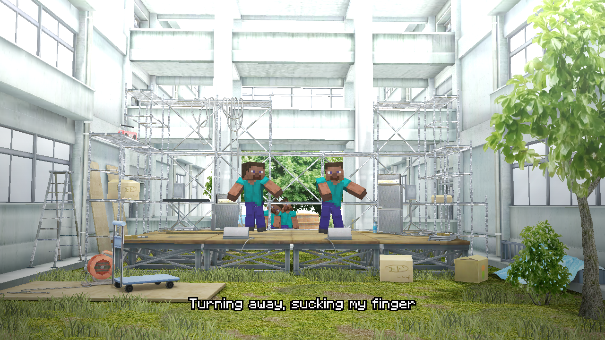

# 史蒂夫跳舞 / SteveDance

在该模组开发过程中广泛使用了人工智能。不同的模组组合和环境仍可能出现问题。如果你不相信AI辅助项目，下载使用前请三思。

## 简介

在 Minecraft 中演奏节奏谱面、观看舞蹈演出。

放置音游街机，选择歌曲和难度开始演奏，也可以观看 PV，让选定角色在世界舞台中演出。

- 四档难度、成绩记录、延迟校准、按键设置和手柄输入。
- 支持原版皮肤，以及已安装的 YSM、车万女仆模型。
- 提供独立演出、世界舞台与纯谱面模式，可调整镜头、光照和场景显示。
- 本体内置五首歌曲。

## 安装与使用

支持 **Windows x64、Minecraft 1.20.1、Forge、Java 17**。本轮客户端验证使用 Forge 47.4.22。

将本体 JAR 放入 `mods`。额外曲包可放入实例目录 `stevedance/packs/`，重启后读取。

合成或从创造模式取得音游街机，放置后右键选曲。选择歌曲与难度，按 Enter 进入歌曲设置；M 选择模型，P 观看 PV。演奏时 Esc 暂停，F1 打开设置。

世界舞台需要定位地毯：先右键街机，再在附近放置地毯。地毯使用任意羊毛与街机无序合成，返还街机。独立演出和纯谱面不需要地毯。

## 设置与兼容

设置菜单：调整音量、键位、延迟及演出选项。

`config/stevedance/visibility.json`：保存 F6 面板中的世界与场景显示选项。

YSM 与车万女仆为可选联动，已检查版本为 YSM 2.6.5、车万女仆 1.5.3。部分 YSM 模型可能出现动作或道具位置不匹配。当前不承诺其他系统、多人或专用服务器支持。

## 下载与源码

- CurseForge：页面准备中 / Page in preparation.
- GitHub Releases：安装包尚未发布 / No installation release yet.
- [构建说明](BUILDING.md)
- [MIT 代码许可](LICENSE)与[素材来源](CREDITS.md)

部分音乐、音效、美术、动作和舞台素材来自原作游戏，相关权利归原权利人所有。如有侵权，请通过 [GitHub Issues](https://github.com/Rotten-flower/SteveDance/issues) 联系删除。自有代码采用 MIT，具体范围见素材说明。

遇到问题可在 [GitHub Issues](https://github.com/Rotten-flower/SteveDance/issues) 反馈，并尽量提供 Minecraft 版本、模组版本、加载器和日志，方便排查。

支持作者：[爱发电](https://afdian.com/a/lbcm233)

## English

AI was used extensively during the development of this mod. Issues may still occur with different mod combinations and environments. If you do not trust AI-assisted projects, please think carefully before downloading and using it.

### Overview

Play rhythm charts and watch dance performances in Minecraft.

Place a Rhythm Arcade, select a song and difficulty, and start playing. Watch PVs or perform on a world stage with your selected characters.

- Four difficulties, records, calibration, configurable controls and gamepad input.
- Vanilla skins and optional installed YSM or Touhou Little Maid models.
- Private Performance, World Stage and Chart-only modes, with camera, lighting and visibility controls.
- Five songs included in the core mod.

### Installation and usage

Supports **Windows x64, Minecraft 1.20.1, Forge and Java 17**. Client checks used Forge 47.4.22.

Put the core JAR in `mods`. Additional song ZIPs go in `stevedance/packs/`; restart after installation.

Craft a Rhythm Arcade or obtain one in creative mode, place it and right-click to select a song. Choose a difficulty and press Enter for song setup; M opens model selection and P opens the PV viewer. Esc pauses rhythm play and F1 opens settings.

World Stage requires a marker carpet. Right-click the arcade, then place its marker nearby. Craft one with any wool and an arcade; the arcade is returned. Private Performance and Chart-only do not require a marker.

### Settings and compatibility

Settings menu: audio, controls, calibration and performance options.

`config/stevedance/visibility.json`: saves world and scene visibility selected in the F6 panel.

YSM and Touhou Little Maid are optional. Checked versions are YSM 2.6.5 and Touhou Little Maid 1.5.3. Some YSM models may have animation or prop-placement mismatches. Other operating systems, multiplayer and dedicated servers are outside the current verified support scope.

### Source and credits

Some music, sound effects, artwork, animations and stages come from the original games. All rights to these materials belong to their respective rights holders. For copyright concerns, please open an issue on [GitHub](https://github.com/Rotten-flower/SteveDance/issues) to request removal. Project-authored code is MIT-licensed. See [Credits](CREDITS.md) and [Building](BUILDING.md).

Please report problems through [GitHub Issues](https://github.com/Rotten-flower/SteveDance/issues). Include your Minecraft version, mod version, mod loader, and logs whenever possible to help us investigate.

Support the author: [Afdian](https://afdian.com/a/lbcm233)

